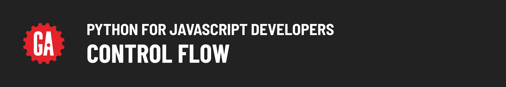

# 

## About

This module introduces Python control flow to JavaScript developers, focusing on fundamental concepts like conditional expressions, Boolean logic, and looping in the context of Python's syntax. It aims to show how these familiar principles translate into Python. By the end, students will have the skills to implement control flow in Python, leveraging their JavaScript background in this new environment.

## Content

| Lesson                                                         | Video Time | Video | Skills                                                           |
| -------------------------------------------------------------- | :--------: | :---: | ---------------------------------------------------------------- |
| [Setup](../setup/README.md)                                     |     --     |  --   | Setting up the development environment.                          |
| [Concepts](../concepts/README.md)                               |     --     |  --   | Review the concepts of control flow.                             |
| [Conditional Expressions](../conditional-expressions/README.md) |     --     |  --   | Writing conditional expressions in Python.                       |
| [If...Else](../if-else/README.md)                               |     --     |  --   | Implementing control flow with `if...else` statements in Python. |
| [Looping](../looping/README.md)                                 |     --     |  --   | Implement looping logic in Python.                               |

## Level Up content

| Lesson                       | Video Time | Video | Skills                                      |
| ---------------------------- | :--------: | :---: | ------------------------------------------- |
| [Ranges](../ranges/README.md) |     --     |  --   | Using the range datatype to loop in Python. |

## References

📖 [Reference Materials](../references/README.md)
