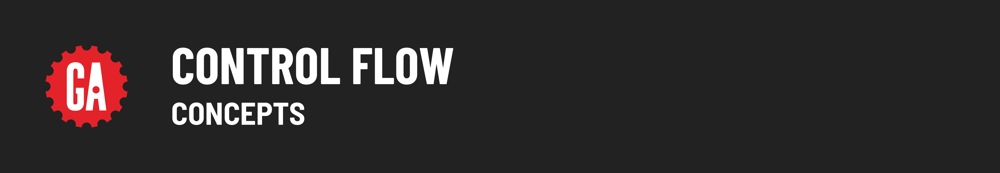

# 

**Learning objective:** By the end of this lesson, students will be able to take their existing knowledge of control flow from JavaScript and use it as framing for their implementation of control flow in Python.

## Review of Control Flow

As you may recall, **control flow** refers to the order in which code executes in a program as determined by the use of constructs in the code.

In JavaScript, we saw how statements such as `if` and `switch` were used to perform **branching**.

We also used statements such as `for` and `while` to perform **looping**.

The good news is that most programming languages, including Python, share these same control flow constructs.

It’s worth pointing out that programming concepts such as variables, data types, control flow, functions, etc. apply to programming languages in general thus making learning additional languages far easier than the first one!
