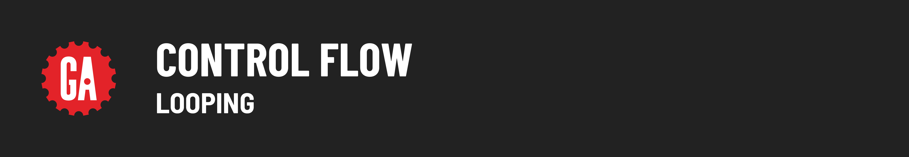

# 

**Learning objective:** By the end of this lesson, students will be able to practice control flow with loops in Python.

## The `for` Statement

Python’s `for` statement is not designed like the one you first used in JavaScript:

```javascript
// A JavaScript for loop
for (let i = 0; i < 10; i++) {
  // do stuff
}
```

Instead, the Python `for` loop always iterates over the items in a _sequence_, similar to JavaScript’s `for...in` and `for...of` loops.

Here’s an idea of how Python’s `for` loop is used to loop through a **list** (Python’s array):

```python
names = ["Emily","Jack", "Sophia", "Ethan"]

for name in names:
  print(name)
```

The Javascript equivalent would be this:

```javascript
let names = ["Emily","Jack", "Sophia", "Ethan"];

for (name of names) {
  console.log(name);
}
```

## The `while` loop

Python also has a `while` loop construct that will continue to iterate **while a given condition is truthy**.

Let’s look at the syntax:

```python
while condition:
  # do some stuff
  # do some more stuff
```

`while` loops are great for when you don’t know how many times you will need to iterate.

> 🚨 Beware of infinite loops! When using while loops, it’s important to ensure that the condition will change to a falsy value so that the loop exits.

## The `break` Statement

Just like in JavaScript, the `break` statement in Python can be used to immediately exit `for` and `while` loops and continue executing any statements that may follow them.

## 🎓 You Do

Wrap the code in **`control_flow_demo.py`** in a `while` loop such that it continues to prompt for a color until the word `quit` is entered.
